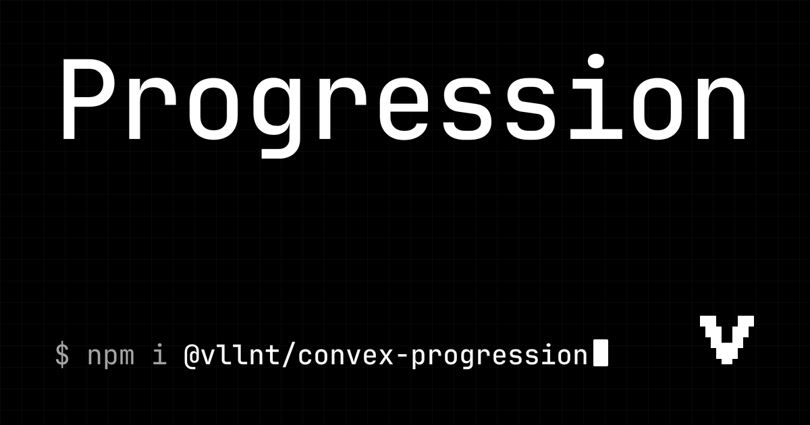

# @vllnt/convex-progression

TypeScript Convex component for gamification: XP totals, levels from your own
thresholds, and activity streaks over days, weeks or any period you define.



## For coding agents

Docs for the installed version are in `node_modules/@vllnt/convex-progression/`:
`docs/API.md`, `llms.txt`, `CHANGELOG.md` and the TypeScript `src/`. Read them
before writing code against this package.

## When to use

- Use it when users earn XP and their level is how many of your XP thresholds
  they have reached.
- Use it when you count a streak of consecutive periods (days, weeks) per user.
- Use it when one user needs several separate tracks, such as one per game mode
  or course (`key`), optionally split by tenant (`scope`).
- Do not use it when the value is spent or transferred (coins, credits): use
  `@vllnt/convex-wallet`.
- Do not use it when an allowance resets on a schedule: use
  `@vllnt/convex-quota`.
- Do not use it when you need leaderboards or ranks: use
  `@convex-dev/aggregate`.

## Install

```bash
pnpm add @vllnt/convex-progression
```

## Quick start

```ts
// convex/convex.config.ts
import progression from "@vllnt/convex-progression/convex.config";
import { defineApp } from "convex/server";

const app = defineApp();
app.use(progression);
export default app;
```

```ts
// convex/progression.ts
import { Progression } from "@vllnt/convex-progression";
import { ConvexError, v } from "convex/values";

import { components } from "./_generated/api";
import { mutation, query } from "./_generated/server";

const progression = new Progression(components.progression);
// XP needed for levels 1, 2 and 3. Host-owned: never take it from the client.
export const THRESHOLDS = [100, 300, 600];

export const completeLesson = mutation({
  args: {},
  returns: v.object({
    level: v.number(),
    leveledUp: v.boolean(),
    xp: v.number(),
  }),
  handler: async (ctx) => {
    const user = await ctx.auth.getUserIdentity();
    if (user === null) throw new ConvexError("not signed in");
    const result = await progression.accrue(
      ctx,
      user.tokenIdentifier,
      "lessons",
      25,
      THRESHOLDS,
    );
    return { level: result.level, leveledUp: result.leveledUp, xp: result.xp };
  },
});

export const myProgress = query({
  args: {},
  returns: v.union(
    v.null(),
    v.object({ level: v.number(), streak: v.number(), xp: v.number() }),
  ),
  handler: async (ctx) => {
    const user = await ctx.auth.getUserIdentity();
    if (user === null) return null;
    const state = await progression.get(ctx, user.tokenIdentifier, "lessons");
    if (state === null) return null;
    return { level: state.level, streak: state.streak, xp: state.xp };
  },
});
```

Run `npx convex dev` once to generate `components.progression`. The component
never reads auth: the host derives `subjectRef` (here the user's
`tokenIdentifier`), the XP award and the thresholds.

## API

Full reference: [docs/API.md](docs/API.md).

| Export                                                                                                | Import from                                      | What it does                                                             |
| ----------------------------------------------------------------------------------------------------- | ------------------------------------------------ | ------------------------------------------------------------------------ |
| [`Progression`](docs/API.md#progression)                                                              | `@vllnt/convex-progression`                      | Host client: `new Progression(components.progression, { defaultScope })` |
| [`accrue(ctx, subjectRef, key, delta, thresholds, scope?)`](docs/API.md#accrue)                       | `Progression` method, mutation                   | Add XP and recompute the level; returns `AccrueResult`                   |
| [`recordActivity(ctx, subjectRef, key, periodKey, thresholds, options?)`](docs/API.md#recordactivity) | `Progression` method, mutation                   | Record activity in a period; returns `ActivityResult`                    |
| [`get(ctx, subjectRef, key, scope?, thresholds?)`](docs/API.md#get)                                   | `Progression` method, query                      | `ProgressState` or `null`                                                |
| [`reset(ctx, subjectRef, key, scope?)`](docs/API.md#reset)                                            | `Progression` method, mutation                   | Delete one progress row; returns `null`                                  |
| [`eraseSubject(ctx, subjectRef, scope?, batch?)`](docs/API.md#erasesubject)                           | `Progression` method, mutation                   | Delete a subject's rows in batches; returns this pass's count            |
| [`ProgressionComponent`](docs/API.md#progressioncomponent)                                            | `@vllnt/convex-progression` (type)               | Type of `components.progression`                                         |
| [`ProgressionOptions`](docs/API.md#progressionoptions)                                                | `@vllnt/convex-progression` (type)               | `{ defaultScope? }`                                                      |
| [`ProgressState`](docs/API.md#progressstate)                                                          | `@vllnt/convex-progression` (type)               | `{ xp, level, streak, maxStreak, updatedAt, lastPeriodKey? }`            |
| [`AccrueResult`](docs/API.md#accrueresult)                                                            | `@vllnt/convex-progression` (type)               | `ProgressState` plus `{ leveledUp, previousLevel }`                      |
| [`ActivityResult`](docs/API.md#activityresult)                                                        | `@vllnt/convex-progression` (type)               | `ProgressState` plus `{ streakDelta }`                                   |
| [`default` (component config)](docs/API.md#convexconfig)                                              | `@vllnt/convex-progression/convex.config`        | Pass to `app.use(...)`                                                   |
| [`register`](docs/API.md#register)                                                                    | `@vllnt/convex-progression/test`                 | Mount the component in `convex-test`                                     |
| [`ComponentApi`](docs/API.md#componentapi)                                                            | `@vllnt/convex-progression/_generated/component` | Generated type of the mounted component                                  |

## Common tasks

Keep a daily streak. Derive the period keys from the server clock; pass
yesterday as `expectedPrevious` so a check-in on consecutive days continues the
streak and a gap restarts it at 1.

```ts
// convex/streaks.ts
import { Progression } from "@vllnt/convex-progression";
import { ConvexError, v } from "convex/values";

import { components } from "./_generated/api";
import { mutation } from "./_generated/server";
import { THRESHOLDS } from "./progression";

const progression = new Progression(components.progression);
const DAY_MS = 86_400_000;
const dayKey = (ms: number) => new Date(ms).toISOString().slice(0, 10);

export const checkIn = mutation({
  args: {},
  returns: v.object({ maxStreak: v.number(), streak: v.number() }),
  handler: async (ctx) => {
    const user = await ctx.auth.getUserIdentity();
    if (user === null) throw new ConvexError("not signed in");
    const now = Date.now();
    const result = await progression.recordActivity(
      ctx,
      user.tokenIdentifier,
      "lessons",
      dayKey(now),
      THRESHOLDS,
      { expectedPrevious: dayKey(now - DAY_MS) },
    );
    return { maxStreak: result.maxStreak, streak: result.streak };
  },
});
```

Award XP at most once per event. `accrue` adds every time it is called, so
record the event in a host table in the same mutation:

```ts
// convex/schema.ts
import { defineSchema, defineTable } from "convex/server";
import { v } from "convex/values";

export default defineSchema({
  awards: defineTable({ eventId: v.string(), subjectRef: v.string() }).index(
    "by_event",
    ["eventId"],
  ),
});
```

```ts
// convex/awards.ts
import { Progression } from "@vllnt/convex-progression";
import { v } from "convex/values";

import { components } from "./_generated/api";
import { internalMutation } from "./_generated/server";
import { THRESHOLDS } from "./progression";

const progression = new Progression(components.progression);

export const awardOnce = internalMutation({
  args: { eventId: v.string(), subjectRef: v.string(), xp: v.number() },
  returns: v.boolean(),
  handler: async (ctx, { eventId, subjectRef, xp }) => {
    const seen = await ctx.db
      .query("awards")
      .withIndex("by_event", (q) => q.eq("eventId", eventId))
      .unique();
    if (seen !== null) return false;
    await ctx.db.insert("awards", { eventId, subjectRef });
    await progression.accrue(ctx, subjectRef, "lessons", xp, THRESHOLDS);
    return true;
  },
});
```

Change the level ladder. Thresholds are not stored: each write stores the level
for the thresholds it was given, and `get` with `thresholds` recomputes the
returned level without writing it.

```ts
// convex/ladder.ts
import { Progression } from "@vllnt/convex-progression";
import { v } from "convex/values";

import { components } from "./_generated/api";
import { query } from "./_generated/server";

const progression = new Progression(components.progression);
const NEW_THRESHOLDS = [50, 150, 400, 1000];

export const levelOnNewLadder = query({
  args: { subjectRef: v.string() },
  returns: v.union(v.null(), v.number()),
  handler: async (ctx, { subjectRef }) => {
    const state = await progression.get(
      ctx,
      subjectRef,
      "lessons",
      undefined,
      NEW_THRESHOLDS,
    );
    return state === null ? null : state.level;
  },
});
```

Erase a user's progress (account deletion). `eraseSubject` deletes one scope per
call; when a batch is full it schedules the next pass itself. Stop the user's
new writes in your own code before you start.

```ts
// convex/account.ts
import { Progression } from "@vllnt/convex-progression";
import { v } from "convex/values";

import { components } from "./_generated/api";
import { internalMutation } from "./_generated/server";

const progression = new Progression(components.progression);

export const eraseProgress = internalMutation({
  args: { subjectRef: v.string() },
  returns: v.number(),
  handler: (ctx, { subjectRef }) => progression.eraseSubject(ctx, subjectRef),
});
```

Mount the component twice, or split one mount by scope. Named mounts share no
tables or scheduled work; a scope is a namespace inside one mount, not access
control.

```ts
// convex/convex.config.ts
import progression from "@vllnt/convex-progression/convex.config";
import { defineApp } from "convex/server";

const app = defineApp();
app.use(progression, { name: "gameProgress" });
app.use(progression, { name: "learningProgress" });
export default app;
```

```ts
// convex/clients.ts
import { Progression } from "@vllnt/convex-progression";

import { components } from "./_generated/api";

export const game = new Progression(components.gameProgress);
export const learning = new Progression(components.learningProgress, {
  defaultScope: "spring-term",
});
```

## Errors and fixes

Invalid input throws a `ConvexError` whose `data` is `{ code, message }`.

| Code                 | Message                                                                                            | Cause                                                                                                                             | Fix                                                                                                                               |
| -------------------- | -------------------------------------------------------------------------------------------------- | --------------------------------------------------------------------------------------------------------------------------------- | --------------------------------------------------------------------------------------------------------------------------------- |
| `INVALID_REF`        | `subjectRef must be 1..256 characters` (or `key`, `scope`, `periodKey`, `expectedPrevious`)        | A mutation got an empty ref or one longer than 256 characters                                                                     | Pass 1..256 characters; hash longer identifiers                                                                                   |
| `INVALID_DELTA`      | `delta must be positive and at most MAX_SAFE_INTEGER`                                              | `accrue` got a `delta` that is 0, negative, `NaN`, infinite or above `Number.MAX_SAFE_INTEGER`                                    | Pass a positive finite number; there is no negative award, use `reset` to start over                                              |
| `INVALID_THRESHOLDS` | `thresholds must be finite and in 0..MAX_SAFE_INTEGER` or `thresholds must be strictly increasing` | A threshold is negative, not finite or above `Number.MAX_SAFE_INTEGER`, or the list is not strictly increasing (writes and `get`) | Pass finite numbers in `0..Number.MAX_SAFE_INTEGER`, ascending without duplicates; `[]` is valid                                  |
| `INVALID_BATCH`      | `batch must be a positive integer`                                                                 | `eraseSubject` got a batch below 1 or not an integer                                                                              | Pass a positive integer or omit it (default 200; above 500 is clamped)                                                            |
| `XP_OVERFLOW`        | `XP exceeds the safe bound or delta is lost to floating-point precision`                           | The new total would exceed `Number.MAX_SAFE_INTEGER`, or adding `delta` does not change the stored total                          | Keep totals at most `Number.MAX_SAFE_INTEGER`; use a larger `delta` on a large total                                              |
| `STREAK_OVERFLOW`    | `streak exceeds MAX_SAFE_INTEGER`                                                                  | Continuing the streak would exceed `Number.MAX_SAFE_INTEGER`                                                                      | Call `recordActivity` without an `expectedPrevious` that matches the stored period (the streak restarts at 1), or `reset` the row |

Arguments of the wrong type (for example a string `delta`) are rejected by
Convex argument validation before the component runs.

## Limits and gotchas

- Refs (`subjectRef`, `key`, `scope`, `periodKey`, `expectedPrevious`) are
  1..256 UTF-16 code units. Mutations reject others with `INVALID_REF`; `get`
  returns `null` for them without an error, since no row can exist.
- One row per `(scope, subjectRef, key)`. `scope` defaults to `"global"`, or to
  the client's `defaultScope`.
- `thresholds` must be strictly increasing, finite and in
  `0..Number.MAX_SAFE_INTEGER`, on every write and on `get` when passed. `[]` is
  valid and keeps the level at 0. The level is the count of thresholds less than
  or equal to the XP, so `[0]` gives level 1 at 0 XP.
- `delta` is a positive finite number up to `Number.MAX_SAFE_INTEGER`; fractions
  use JavaScript floating-point addition. XP never decreases except through
  `reset` or `eraseSubject`.
- `accrue` is not event-idempotent: two calls add twice. Deduplicate in the host
  (see Common tasks).
- `previousLevel` is the level stored by the previous write, which may come from
  another ladder; `leveledUp` is `level > previousLevel`.
- `recordActivity` with the stored period again leaves the streak unchanged and
  returns `streakDelta: 0`, but it still writes: `level` is recomputed and
  `updatedAt` is refreshed.
- Without a matching `expectedPrevious`, every new period restarts the streak
  at 1. `streakDelta` is `1` for every new period, including a restart; it is
  not the change in `streak`.
- Periods are opaque strings, not dates. Only the last one is stored, so
  replaying an older period restarts the streak. Reject late activity in the
  host.
- `accrue` does not touch streaks and `recordActivity` adds no XP. A row created
  by `accrue` has `streak: 0` and no `lastPeriodKey`.
- `get` with `thresholds` changes only the returned `level`; the stored level
  changes on the next write.
- `reset` returns `null` whether or not a row existed.
- `eraseSubject` erases one scope per call. Batches default to 200; a batch
  above 500 is clamped to 500 without an error. It returns only the rows deleted
  by that call, and there is no completion signal. It has no write fence: rows
  written while passes run may be deleted or may survive. `reset` does not
  cancel pending passes.
- There is no leaderboard, ranking, calendar logic or React entry.

## Compatibility

- Peer dependency: `convex@^1.45.0`. CI runs the unit tests on the locked convex
  version (1.51.0), and type-checks the packed package and the README examples
  against convex 1.45.0.
- Node.js `>=20`. ES modules (`"type": "module"`).
- Node.js 22 or later for convex 1.49 and newer, which require it.
- `@vllnt/convex-progression/test` ships as TypeScript source and needs
  `convex-test`, `vitest`, `vite` (for `import.meta.glob` and the `vite/client`
  types) and `@edge-runtime/vm`. CI type-checks it with `convex-test` 0.0.65 and
  runs this repository's tests with 0.0.73. Vite 8 needs Node.js `^20.19.0` or
  `>=22.12.0`; Vitest 5 needs Node.js `^22.12.0`, `^24` or `>=26`.
- React: not applicable. The package is backend-only and has no `./react` entry.

## Testing

Mount the component in your own `convex-test` suite with `register`. Use the
Vitest settings `convex-test` recommends (edge runtime, `convex-test` inlined):

```ts
// vitest.config.mts
import { defineConfig } from "vitest/config";

export default defineConfig({
  test: {
    environment: "edge-runtime",
    server: { deps: { inline: ["convex-test"] } },
  },
});
```

```ts
// convex/progression.test.ts
/// <reference types="vite/client" />
import { register } from "@vllnt/convex-progression/test";
import { convexTest } from "convex-test";
import { expect, test } from "vitest";

import { api } from "./_generated/api";
import schema from "./schema";

test("a lesson awards 25 XP", async () => {
  const t = convexTest(schema, import.meta.glob("./**/*.ts"));
  register(t);
  const user = t.withIdentity({ tokenIdentifier: "user-1" });
  const result = await user.mutation(api.progression.completeLesson, {});
  expect(result).toEqual({ level: 0, leveledUp: false, xp: 25 });
});
```

`register(t, name)` takes the mount name when you used
`app.use(progression, { name })`.

This repository's own tests use the simulated `convex-test` runtime
(`pnpm test:coverage`, 100% coverage enforced), not a real Convex backend.
`scripts/check-local.mjs` is a smoke test against a local backend; see
[CONTRIBUTING.md](https://github.com/vllnt/convex-progression/blob/main/CONTRIBUTING.md#package-checks).

## Security

- The component does not authenticate. The host must authorize every call and
  derive `subjectRef`, `key`, `scope`, period keys, `delta` and `thresholds`
  itself; never accept them from the client.
- Its `progress` table is reachable only through the component's functions.
- The host deduplicates awards, rejects late activity and blocks writes while
  erasing. See [lifecycle and retries](docs/API.md#lifecycle-and-retries).

Report vulnerabilities as described in
[SECURITY.md](https://github.com/vllnt/convex-progression/blob/main/SECURITY.md).

## Related packages

None. This package has no dependency, shared test or example with another
package.

## Contributing

See
[CONTRIBUTING.md](https://github.com/vllnt/convex-progression/blob/main/CONTRIBUTING.md).

## Links

- Docs and changelog: [oss.vllnt.com/packages/convex-progression](https://oss.vllnt.com/packages/convex-progression) · [release feed](https://oss.vllnt.com/packages/convex-progression/rss.xml)
- All @vllnt packages: [oss.vllnt.com](https://oss.vllnt.com) · [search packages and docs on index.vllnt.com](https://index.vllnt.com)
- Source and issues: [GitHub](https://github.com/vllnt/convex-progression) · [issues](https://github.com/vllnt/convex-progression/issues) · [npm](https://www.npmjs.com/package/@vllnt/convex-progression)
- Questions and updates: [Discord](https://bntvllnt.com/discord) · [X @bntvllnt](https://x.com/bntvllnt)
- Company and author: [vllnt.com](https://vllnt.com) · [bntvllnt.com](https://bntvllnt.com) · [GitHub @bntvllnt](https://github.com/bntvllnt) · [LinkedIn](https://linkedin.com/in/bntvllnt)
- Sponsor: [GitHub Sponsors](https://github.com/sponsors/bntvllnt)

## License

MIT. See [LICENSE](LICENSE).

[](https://www.npmjs.com/package/@vllnt/convex-progression)
[](https://github.com/vllnt/convex-progression/actions/workflows/ci.yml)

---

Part of [vllnt open source](https://oss.vllnt.com) · [Package page](https://oss.vllnt.com/packages/convex-progression) · [vllnt.com](https://vllnt.com) · Built by [bntvllnt](https://bntvllnt.com)
